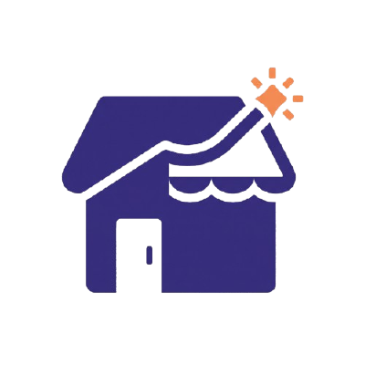

<p align="center">
  
</p>

<h1 align="center">TendIA · Landing page</h1>

<p align="center">
  <b>Crédito basado en tu negocio, no en tu pasado bancario.</b><br>
  Página pública de <a href="https://github.com/TendIA-IETI-Team/tendia">TendIA</a>: explica el Puntaje TendIA y lleva al tendero a la app y a la entidad al portal.
</p>

## Correr en local

Requiere Node 22 y pnpm 9.

```bash
pnpm install
pnpm dev          # http://localhost:3100
```

| Comando                                 | Qué hace                                                          |
| --------------------------------------- | ----------------------------------------------------------------- |
| `pnpm lint` · `pnpm typecheck`          | ESLint y TypeScript                                               |
| `pnpm build` · `pnpm start`             | Build de producción y servidor en el puerto 3100                  |
| `pnpm test`                             | Playwright + axe en móvil y escritorio (corre `pnpm build` antes) |
| `pnpm exec playwright install chromium` | Instala el navegador de las pruebas (una vez)                     |

## Variables de entorno

Todas son opcionales; sin ellas la página usa los valores de staging.

| Variable                    | Para qué                                                                             |
| --------------------------- | ------------------------------------------------------------------------------------ |
| `NEXT_PUBLIC_APP_URL`       | App del tendero                                                                      |
| `NEXT_PUBLIC_PORTAL_URL`    | Portal del aliado                                                                    |
| `NEXT_PUBLIC_API_DOCS_URL`  | Documentación de la API                                                              |
| `NEXT_PUBLIC_REPO_URL`      | Repositorio principal (enlaces legales y de equipo)                                  |
| `NEXT_PUBLIC_CONTACT_EMAIL` | Correo de "Quiero ser aliado". Sin él, ese botón se reemplaza por "Probar el portal" |
| `NEXT_PUBLIC_SITE_URL`      | URL canónica, sitemap y Open Graph. En Vercel se usa el dominio de producción        |

## Despliegue

Vercel conectado a este repositorio: `main` va a producción y cada PR genera una vista previa. Web Analytics de Vercel (sin cookies) se activa en el panel del proyecto.

## Sistema de diseño

La página implementa el sistema de diseño de TendIA:

| Qué                                                                                       | Dónde                                                                      |
| ----------------------------------------------------------------------------------------- | -------------------------------------------------------------------------- |
| Especificación de la landing (stack, secciones, criterios de aceptación, plan de trabajo) | [`docs/design-system/landing-spec.md`](docs/design-system/landing-spec.md) |
| Manual de marca (voz, color, tipografía, logo)                                            | [`docs/design-system/README.md`](docs/design-system/README.md)             |
| Tokens (colores, tipografía, espaciados, radios)                                          | [`docs/design-system/tokens.json`](docs/design-system/tokens.json)         |
| Componentes: guía + vista previa HTML de cada sección                                     | [`docs/design-system/components/`](docs/design-system/components/)         |
| Logo y capturas reales del producto                                                       | [`public/`](public/)                                                       |
| Instrucciones para Claude Code                                                            | [`CLAUDE.md`](CLAUDE.md)                                                   |

Para ver un componente, abre su `preview.html` en el navegador (por ejemplo `docs/design-system/components/Hero/preview.html`).

Los tokens vienen de [`packages/tokens`](https://github.com/TendIA-IETI-Team/tendia/tree/main/packages/tokens) del repositorio principal. Si cambian allá, actualiza `docs/design-system/tokens.json`.

Los estilos de los componentes están en `src/styles/components.css` (clases `td-`, las mismas de `docs/design-system/components/bundle.css`) y los tokens en `src/styles/tokens.css` y `tailwind.config.ts`.

## Stack

Next.js 15 (App Router, todo estático) · TypeScript · Tailwind CSS 3 · Nunito (`next/font`) · Playwright + axe · Vercel.

## Enlaces del producto

- App del tendero: https://tendia-app.vercel.app/app
- Portal del aliado: https://tendia-app.vercel.app
- API pública: https://tendia-app.vercel.app/api/docs

<p align="center"><sub>Proyecto de IETI · Escuela Colombiana de Ingeniería Julio Garavito · 2026</sub></p>
